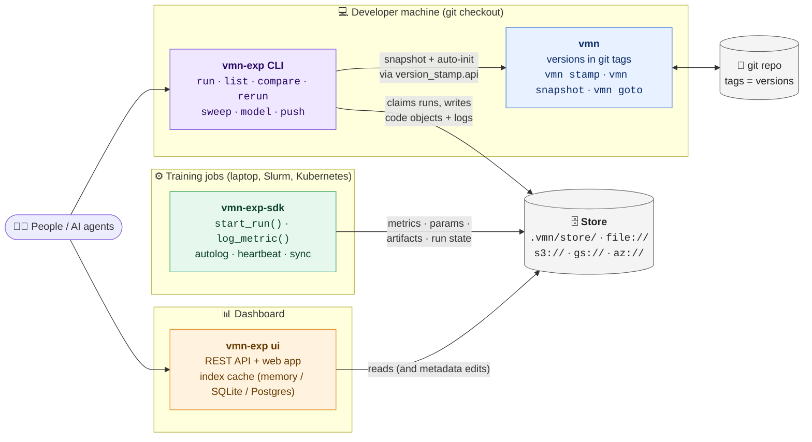
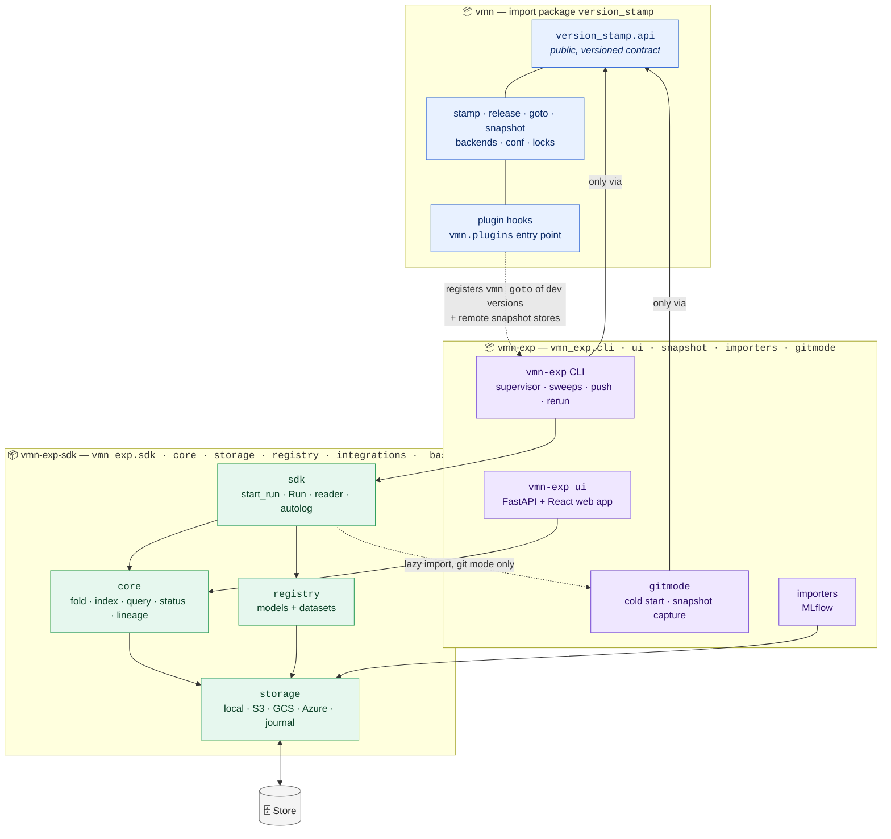
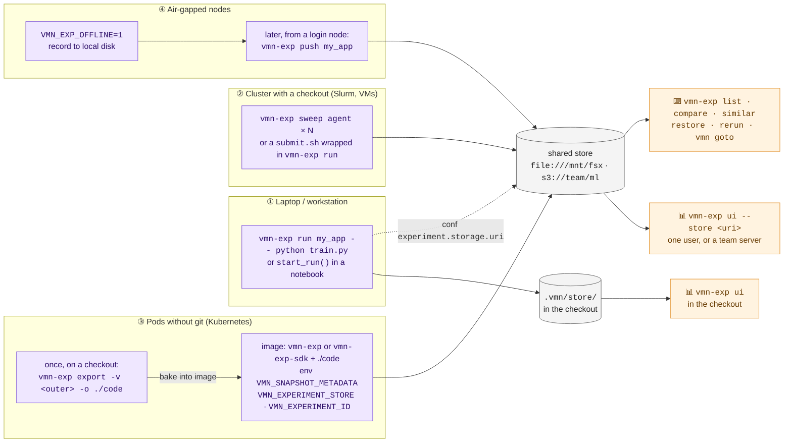
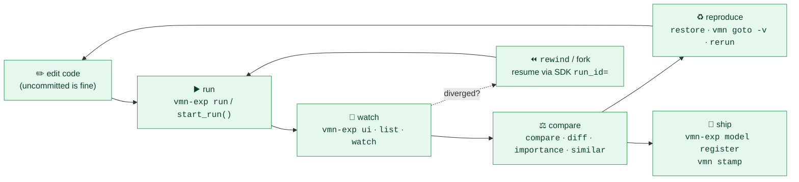
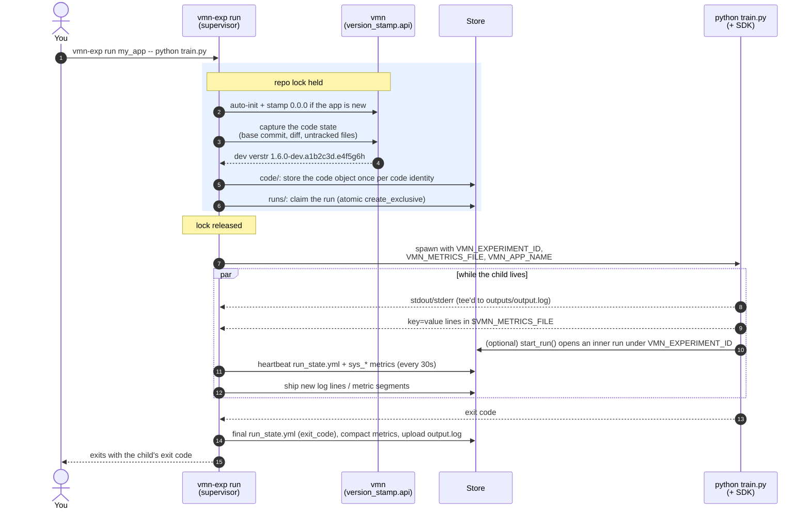
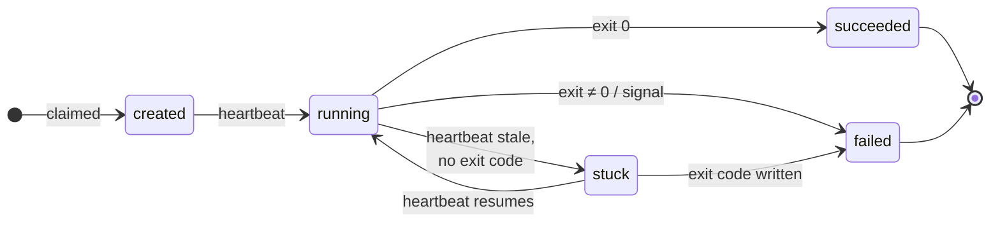
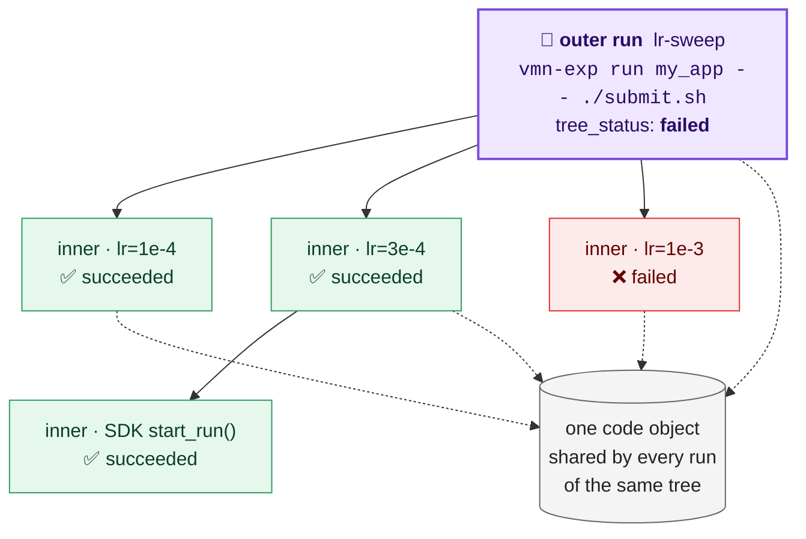
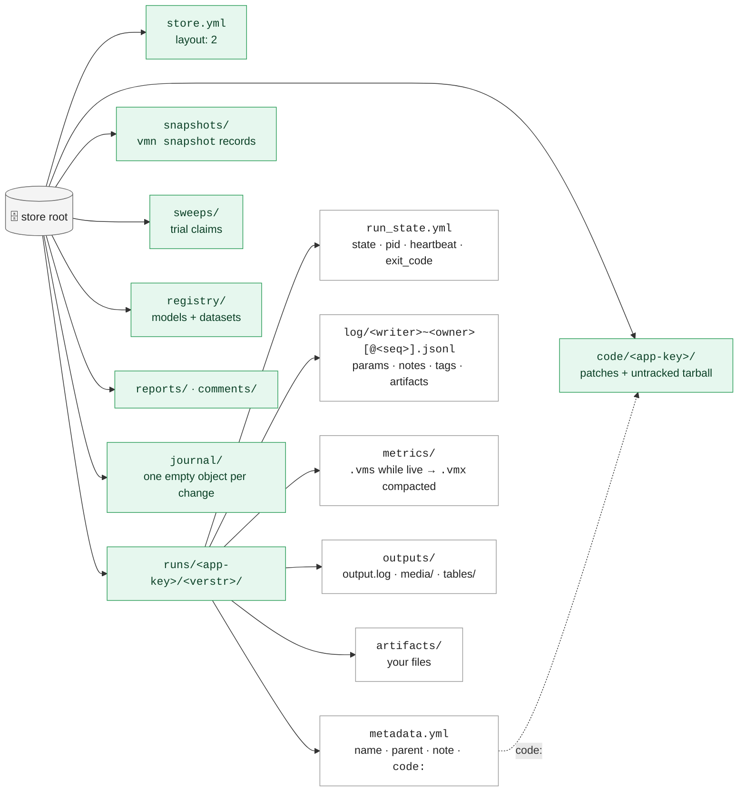
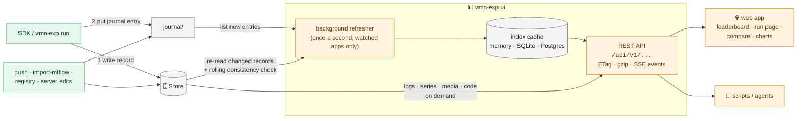
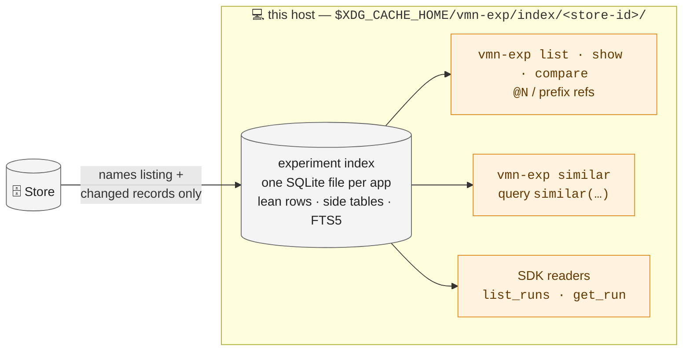

# Architecture

How vmn-exp fits together: the three packages, the store they share, how a run
is recorded, and how clients use it, from a laptop to a fleet of pods. The
diagrams are Mermaid, so they render on GitHub and in most Markdown viewers.

- [The big picture](#the-big-picture)
- [Three packages, one store](#three-packages-one-store)
- [How clients use it](#how-clients-use-it)
- [The life of a run](#the-life-of-a-run)
- [Outer runs and inner runs](#outer-runs-and-inner-runs)
- [Inside the store](#inside-the-store)
- [How the dashboard reads the store](#how-the-dashboard-reads-the-store)

---

## The big picture

The store is the source of truth. Everything else writes to it or reads from
it. No component talks to another over the network: jobs never contact the
dashboard, and the dashboard never hands jobs credentials.

| Piece | Install | What it does |
|---|---|---|
| **vmn** | `pip install vmn` | Versioning in git tags. Knows nothing about experiments; provides `vmn snapshot` and the public `version_stamp.api` that vmn-exp builds on. |
| **vmn-exp-sdk** | `pip install vmn-exp-sdk` | The job-side writer: `start_run()`, logging, autolog, readers, the model registry, every storage backend. Needs neither git nor vmn. |
| **vmn-exp** | `pip install "vmn-exp[ui]"` | The platform: the `vmn-exp` command, git-mode capture, the MLflow importer and the `vmn-exp ui` dashboard. Pulls in the other two. |
| **Store** | a directory or a bucket | Plain files: runs, code, sweeps, registry, reports, a change journal. See [Inside the store](#inside-the-store). |

---

## Three packages, one store

The import rules are enforced by tests
(`packages/vmn-exp/tests/test_packaging_split.py`), so the SDK stays small
enough for a job image and vmn-exp can move to its own repository. Details:
[packaging.md](../packaging.md).

- `version_stamp` never imports `vmn_exp`. vmn finds vmn-exp only through the
  `vmn.plugins` entry point, which adds `vmn goto` of dev versions and remote
  stores for `vmn snapshot`.
- The SDK imports neither `version_stamp` nor the vmn-exp subpackages. The
  only exception is a lazy `vmn_exp.gitmode` import, used when `start_run()`
  must snapshot a git checkout. Without vmn-exp installed that path fails with
  "install vmn-exp for git mode", and git-free runs work as usual.
- vmn-exp reaches vmn only through `version_stamp.api`.
- `vmn_exp` is a namespace package split across vmn-exp-sdk and vmn-exp, so
  both install into the same `vmn_exp` import name.

---

## How clients use it

The same store serves every way of running. Pick the row that matches where
your jobs run. [client-guide.md](client-guide.md) walks through each one.

Where runs go is resolved the same way everywhere (CLI, SDK, `vmn snapshot`):
`--store` > `VMN_EXPERIMENT_STORE` > conf `experiment.storage.uri` > the
checkout's `.vmn/store/`. `VMN_EXP_OFFLINE` drops the remote store in all of
them.

### The loop a client goes through

---

## The life of a run

What `vmn-exp run my_app -- python train.py` does. The repo lock is held only
while the run is created, so a long run never blocks other `vmn` commands, and
the child can open nested runs of its own.

Status is derived from `run_state.yml`, never stored: `running` while the
heartbeat is fresh, `succeeded`/`failed` from the exit code, and `stuck` when
the heartbeat goes stale with no exit code (a node that vanished).

---

## Outer runs and inner runs

A run created while `VMN_EXPERIMENT_ID` is set becomes an inner run of that
run, so nesting falls out of how you launch jobs. An outer run's
`tree_status` rolls up its subtree (`failed > stuck > running > created >
succeeded`).

Sweeps work the same way: `vmn-exp sweep create` stores the spec on an outer
run, and each `vmn-exp sweep agent` claims trial slots and runs every trial as
an inner run ([sweeps.md](sweeps.md)).

---

## Inside the store

Every store root has the same areas, so a bucket policy is a list of prefixes
([byo-bucket.md](byo-bucket.md)). Records are append-only: a writer adds new
log segments and never rewrites another writer's files, which is why hosts
sharing a bucket or an NFS directory never collide.

Per-host state (the index cache, the push ledger) lives outside the store, in
the XDG cache/state directories, so the store holds only shared, durable data.
Full layout: [experiments.md](experiments.md).

---

## How the dashboard reads the store

`vmn-exp ui` folds every run into one row (params, metric summaries, tags,
status) and keeps those rows in an index cache, so the leaderboard answers
from memory even at 100k runs. Logs, series, artifacts and code are read from
the store on demand. The cache can be deleted at any time and is rebuilt
from the store.

- **Store workspaces** (`--store`) follow the change journal: each tick lists
  the journal's last two minutes (its whole 5-minute skew window every 30 s),
  then only the named records are re-read; a live run is re-listed for its
  heartbeat once per heartbeat interval (at least 10 s apart, at most half its
  stuck window), since heartbeats are not journaled.
- **Git workspaces** (`--repo`) have no journal and are refreshed by listing.
- **As a team server** (`--config server.yml`), the same process adds sign-in,
  API tokens, roles and an optional Postgres cache shared by replicas
  ([server.md](server.md)). Jobs still write only to the store.

See [ui.md](ui.md) for the flags and the HTTP API.

### CLI and SDK reads: the per-host index

`vmn-exp list`, `show`, `compare`, `similar`, ref resolution and the SDK
readers go through the same kind of cache: one SQLite file per app per store
on each host, outside the store. A refresh lists record names plus whatever
changed, and resolving one run is a point read, so thousands of runs stay
cheap. The file also holds each run's similar-runs document in an FTS5
table, which `vmn-exp similar` and the query language's `similar("<text>")`
search.

Deleting the file costs one rebuild, never data
([The experiment index](experiments.md#the-experiment-index-per-host-cache)).
